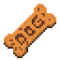

# DesktopDog-StarDance
A Dog for your Desktop!

## What is Desktop Dog?
Desktop Dog is an App for your PC which    gives you an Interactive Desktop Pet!

## Functions:

### Walking Around
Just the complete basic, your Dog walks around   your desktop and sleeps every once in a while.
### Dragging your Dog
You can left-click your Dog and move it anywhere you like!
    
### Throwing a Ball
There will be a red ball on your screen   by left-clicking it you can move it around as    well. Once you dropped the ball the dog will fetch it    after he did he'll walk around with it until you   take it from him by making a right click on the dog!
 

### Giving a Treat
There will also be a dog treat on your screen   when taking it by left-clicking on the treat the dog    will stop whatever he's doing and sit.   If you want to treat him simply drag the treat above the dog,   once he performed a trick you'll have to move the treat away   from him and put it above him again   if you´d like him to perform the trick again. 
#### Important 
If you want to stop the Treating simply let go of the treat!!  

### Dog-House
You´ll also notice a Dog-House on your Screen. Left-Click it   and the dog will go inside and STAY. If you want him out   simply click again. The House will be placed somewhere on your screen.   If you´d like to move it right-click the house and drag it anywhere you like!
#### Important
The Dog Will not react to anything while in his house!  

### Credits for the Sprites:
[Treat](https://www.food4rhino.com/en/resource/dog-treat)  
House: Pinterest  
Ball: Did it myself  
Dog: Forgot the Link :( but THANKS!!
